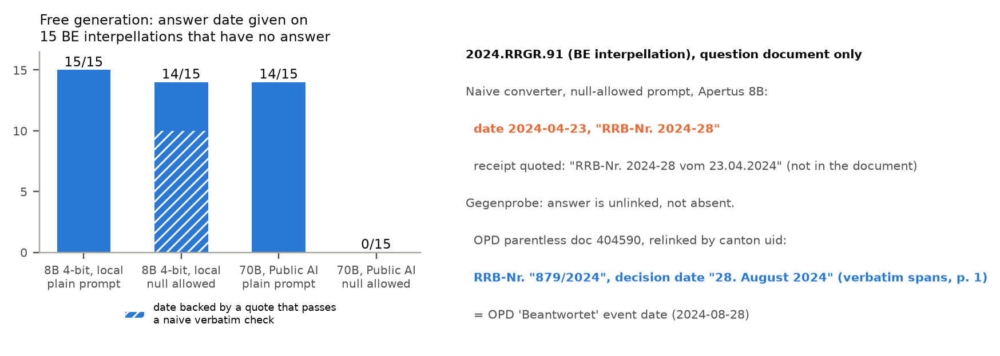

# Gegenprobe — Track 2A, OpenParlData

**Extracting parliamentary affairs from PDFs into one common structure**, built for OpenParlData (OPD), Switzerland's open
parliamentary database. Apertus never writes a value here: it can only point at a value that is printed in the document,
or say null.

OPD's stated goal is "to create transparency, promote participation and enable data-based political education". We
measured how far the corpus carries that promise for the object most citizens care about, the government's answer to a
parliamentary question:
- **Reality:** of 91,268 interventions whose events record a written answer, **16,749 (18.4%) have no answer text in
  OPD**. In Bern only 229 of the 3,532 answers the canton publishes (6.5%) are attached to their affair, yet most of the
  rest already sit in OPD, unlinked. OPD confirmed the cause (correspondence, 10 Oct 2026): the answer reaches OPD
  from two sources with the same document id and staging keeps the first parent it sees; a fix is pending, and until then
  the relink list below is the workaround.
- **Repair:** in Bern, 3,394 of the canton's answers (96.1%) are linkable within OPD without any model: 229 attached,
  527 under an agenda item, 2,638 as parentless documents. The relink list (prepared for OPD) relinks 2,459 of the parentless ones and
  fetches 49; the other 179 parentless answers belong to affairs whose answer text is already in OPD (155) or that OPD
  records without a written-answer event (24), so they are not missing (`results/repair/be_reconcile.json`). Across
  Switzerland, 3,107 missing answers are recoverable by deterministic routes (agenda join, Bern relink and fetch, federal
  Curia Vista); the Bern relink is sample-verified (affair number and answer heading 40/40 on a pre-registered sample,
  decision date 36/40, one miss being a typo in the canton's own PDF), the agenda join and Curia routes are not. 1,008
  Valais "missing" answers are in fact oral, and 11,206 need per-parliament source adapters. That last number is the
  honest remainder, stated as such.
- **Second list for OPD:** 727 Bern affairs whose `begin_date` is a load timestamp, not a date of the affair: 557 on
  2024-10-28 (numbers mostly 2010–2013) and 170 from later loads — the two groups OPD described (correspondence,
  10 Oct 2026). 563 get their own "Eingereicht" event date; 164 are flagged for review
  (`results/repair/repair_BE_begin_date.tsv`).
- **Schema:** a field-by-field verdict over 89 parliaments says which parts of an affair can be represented consistently
  and where the parliaments differ (below).
- **Converter:** rules first; Apertus is a closed-set pointer with a calibrated null, every value with page and
  character span. After the pre-registered held-out test the default mode is **rules only**; Apertus runs on the rules'
  residue as a review suggestion (`src/gegenprobe/convert/modes.py`, below). The naive alternative, Apertus generating the JSON freely from a plain prompt, gives an answer date for
  15/15 (local 8B) and 14/15 (70B) Bern interpellations that have no answer; a null-allowed prompt fixes this on the 70B
  (0/15) but not on the local 8B (still 14/15).

## Quickstart

```bash
make run              # Docker, CPU, clean checkout: replays every headline from committed inputs (see below)
make census-replay    # recompute the census, link status and feasibility matrix from data/census only (host Python)
make test             # unit tests (host Python 3.11: pip install -e .[dev])
```

`make run` needs nothing but Docker. Optional: `LLM_NAME` / `LLM_BASE_URL` / `LLM_API_KEY` for a live Apertus slice over
any vLLM-style endpoint, or `make run GGUF=1` to score the live slice locally with Apertus v1.5 8B (GGUF Q4_K_M, CPU,
sha256-pinned download). Without them, model outputs are replayed from the hash-keyed cache in `data/model_cache/`.

What `make run` does (`src/gegenprobe/run.py`; it exits non-zero on any failure):
1. **model** — detects a live backend, otherwise replays.
2. **census** — recomputes the national funnel, answer-link status and the feasibility matrix from `data/census/` and
   asserts equality with `results/census/`.
3. **repair** — the Bern canton-uid join on a vendored slice, and the triple check (affair number printed, answer heading,
   decision date = OPD event date) on PDFs fetched by pinned sha256.
4. **convert** — sample documents through the cascade; span re-check, typed nulls, footer-distractor and self-deletion
   tests; live pointer margins compared with the committed cache.
5. **eval** — re-scores the committed evaluation results and prints the scoreboard.
6. **claims** — every number in this README and the report is recomputed from a results file in this repository
   (`claims.tsv`); figures cited from earlier spikes are marked as cited (`results/report/cited_spikes.json`), not recomputed.

Network access is optional: without it, the live slices report SKIP and everything else still replays.

## What is in the repository

| Deliverable (challenge) | Where |
|---|---|
| Representation model: versioned schema + controlled vocabularies | `src/gegenprobe/schema/schema_v0_1.py`, `data/schema/*.json`, JSON Schema `results/schema/*.schema.json`, `docs/schema.md`, mapping to Popolo / Akoma Ntoso / Parla-CLARIN / OParl in `docs/mapping.md` |
| Converter: prompts + code, provenance per value | `src/gegenprobe/convert/` (lattice → rules → pointer → cascade), prompts `src/prompts/{de,fr,it}/`, `docs/converter.md` |
| Validator | `src/gegenprobe/validate/` (schema, span re-check, typed-null consistency, self-deletion and distractor harnesses) |
| Evidence: gold set, evaluation, pre-registration | `data/gold/`, `eval/`, `eval/prereg/{PREREG.md,LOCK,DEVIATIONS.md}`, `docs/gold_protocol.md` |
| Cross-parliament question | `results/census/question.json`, `docs/census.md` |
| Census, feasibility matrix, data-quality findings | `src/gegenprobe/census/`, `results/census/`, `docs/census.md` |
| Repair lists in OPD's export layout | `results/repair/repair_<body>.{tsv,json}`, `docs/repair.md` |
| Nightly job (systemd timer + container) | `src/gegenprobe/monitor/`, `deploy/nightly/`, `make install-nightly`, `docs/nightly.md` |

## Is a common schema feasible? (`results/census/matrix.json`, criteria in `docs/census.md` §3, written down before computing; not separately committed)

Over 17 fields and 89 parliaments, **4 fields are feasible** from OPD metadata alone (submission date, answer date —
the answer-event date, which in 7 of 54 bodies is the submission date for most affairs — procedural history,
answer-link status), **13 are partial** (in the metadata for some parliaments, only in the PDF for
others: type, submitter, co-signatories, addressed body, Q/A pairing, dispatch and decision dates, decision outcome,
government recommendation, procedural state, related affairs, language, usable document text), and **0 are fundamentally
different** by the pre-declared rule. Where the concept itself splits (oral answers, question time, same-day "answer"
events) is shown separately, as is a negative result: schema completeness cannot be estimated lexically (no saturation).


## Sample outputs (dev documents; full files in `docs/samples/`)

Every value carries its route, page and character span; a null is typed. Excerpts:

**Bern government decision** (`docs/samples/be_rrb_rule.json`), found by rule next to its "RRB-Nr.: … vom" anchor:
```json
{"kind": "value", "value": "2024-08-28", "role": "answer_decided", "basis": "normalised", "route": "rule",
 "doc": "be-ogd:0778ef860e7d4e5c8ab89d1fe2922a42", "page": 1, "char_start": 437, "char_end": 452,
 "quote": "28. August 2024", "context": "vom 28. August 2024"}
```

**Ticino government answer** (`docs/samples/ti_answer_rule_and_pointer.json`): the rule reads "RG n. 3272 del 28 giugno
2022"; the Apertus pointer, scored over the three dates printed in the document plus null, agrees.
```json
{"value": "2022-06-28", "route": "rule", "page": 2, "char_start": 59, "char_end": 73, "quote": "28 giugno 2022",
 "context": "RG n. 3272 del 28 giugno 2022"}
```

**Ticino question as lodged** (`docs/samples/ti_question_typed_null.json`): no rule anchor; Apertus is asked, and its null
margin is far above the calibrated threshold, so the field is a typed null instead of a guessed date.
```json
{"route": "apertus", "null_reason": "not_in_document",
 "apertus_pointer": {"value": null, "margin": 88.25, "theta": 10.40, "argmax": "2020-09-07", "n_candidates": 2}}
```



## Evaluation (held-out, pre-registered)

154 held-out documents (German/French/Italian × canton/commune, plus Ticino scans through OCR; 64 with an answer date,
90 without), labels by blind double annotation with no human judgement (`docs/gold_protocol.md`), registration locked
before any label existed (`eval/prereg/PREREG.md`, `eval/prereg/LOCK`, commit `812030f`; labels commit `ded0033`),
deviations in `eval/prereg/DEVIATIONS.md`. Answer date, strict, frozen code; Apertus = 70B weights served as
`swiss-ai/apertus-v1.5-8b` (details: report §6).

| arm | exact [95% CI] | wrong date printed in the document | fabricated | values on the 90 answerless |
|---|---|---|---|---|
| **rules only (default mode)** | **135/154 [81.5, 92]** | 4 | 0 | 2 |
| pointer (Apertus on every document) | 130/154 [77.9, 89.3] | 16 | 0 | 6 |
| cascade: rules, then pointer on the residue | 139/154 [84.6, 94] | 11 | 0 | 7 |
| naive free generation, plain prompt | 98/154 [55.8, 70.8] | 23 | 24 | 39 |
| naive free generation, null-allowed | 134/154 [80.8, 91.4] | 11 | 0 | 3 |
<!-- SLOT: 8B rows -->

- **H1 null safety: FAIL.** The cascade puts a value on 7 of 90 answerless documents (upper Wilson bound 15.2%, target 10%).
- **H2: Branch B.** Cascade vs rules on the French, Italian and OCR cells: 5 documents only the cascade gets right,
  1 only the rules (exact McNemar p = 0.22). Apertus does not measurably add null-safety over the rules (values on
  answerless documents: cascade 7/90, rules 2/90), so under the registered rule it is **not kept in the unattended
  path**: the default mode is rules only, and the pointer's answers on the rules' residue are review suggestions.
- **H3: PASS.** The pointer's null margin separates answerless from answered documents with AUROC 0.969.
- **H4: triggered.** 3 of 8 Apertus-decided French/Italian values are wrong; the post-hoc θ sweep is in the report.

The honest reading: the rules carry the extraction. Accepting every pointer answer on the residue would cut false nulls
from 15 to 4 but add misattributions (wrong dates printed in the document 4 → 11; values on answerless documents 2 → 7),
so a reviewer, not the pipeline, accepts them: each suggestion arrives with page, span and margin. A well-prompted 70B
(null-allowed) is about as accurate as the cascade. What the closed-set pointer adds is structural: it cannot fabricate
a value, every value has page and span, and its margin separates answered from answerless documents (AUROC 0.969),
though the frozen θ was too permissive (H1 failed). The naive plain prompt fabricates 24 dates.


## Use of Apertus

- **Where:** only in the converter, and only as a closed-set pointer: forced choice over the dates (or enum labels, or
  OPD affair numbers) that occur in the document, plus null; summed log-probabilities; null if its margin exceeds a
  threshold θ fitted per build on dev documents. Free generation is used only to measure the naive baseline.
- **Builds:** development and evaluation ran on Public AI. Its `swiss-ai/apertus-v1.5-8b` name serves the **70B**
  weights (measured, see the report), so results labelled "Public AI" are 70B results. The 8B runs locally as GGUF
  Q4_K_M on CPU (llama.cpp); θ does not transfer between builds, so each build gets its own.
- **Modes:** `rules_only` (default, unattended, no model) and `review` (the pointer on the rules' residue; its value is a
  suggestion with page, span, margin and `needs_review: true` for OPD's existing manual-review step). This follows the
  pre-registered Branch B: Apertus did not measurably add null-safety over the rules on held-out documents, so it does
  not write values unattended. The report states where it fell short.

## Sovereignty and runtime dependencies

The running system contacts only the sources it repairs and, optionally, the model endpoint its operator chooses:

| Service | What is sent | Needed for |
|---|---|---|
| files.openparldata.ch (exports) | nothing but GET requests | census, nightly job |
| ogd.parl.apps.be.ch, rrgr-service.apps.be.ch (canton Bern) | GET; an affair number for the per-affair route | BE repair |
| fedlex.data.admin.ch (SPARQL), www.fedlex.admin.ch (filestore) | a citation such as "BBl 2014 9657" | CHE placeholder repair |
| document hosts listed in OPD | GET of a public PDF | conversion |
| ws.parlament.ch (Curia Vista OData) | a federal affair number | CHE answers missing from the texts export |
| huggingface.co, only with `GP_GGUF=1` | GET of the pinned GGUF weights (once) | local 8B scoring |
| the LLM endpoint the operator sets (`LLM_BASE_URL`) — or none | document text of public parliamentary documents | the Apertus pointer |

**Cost.** The default `rules_only` mode needs no model: measured on the held-out texts, the rules would take about
0.5 CPU-hours for all 902,754 documents in OPD's export. In `review` mode the pointer runs only on the rules'
residue (97 of 154 held-out documents, 63%), with 3.5 calls per residue document and 5,905 billed prompt tokens
(1,593 unique prefill tokens) on average; projected to OPD's 902,754 documents that is about 3.4 billion billed prompt
tokens, $336 at Public AI's list price for that name ($3,357 at ten times the volume); a server with prefix caching
computes far fewer (`results/report/cost.json`; the residue share comes from a stratified sample, not the corpus mix).

With `GP_GGUF=1` the model runs in-process on CPU and no document text leaves the machine. Public AI was used for
development and evaluation only; it may route requests outside Switzerland and is not a runtime target. All requests use
the User-Agent `hackapertus-research/0.1`, respect robots.txt (OPD's `/v1/` API is disallowed and never called) and keep at
least 1.2 s between requests to one host.

## Maturity, limitations, coding assistants

- **Maturity:** census and repair: deployable prototype (nightly job, systemd units, outputs in OPD's export layout).
  Extraction: feasibility study.
- **Limitations:** 11,206 missing answers need per-parliament adapters that are not built; OCR recovered 15/15 scans of a
  probe, not the backlog; the converter covers the answer date, government recommendation and related-affair links,
  not every schema field.
- **Coding assistants:** most code was written by Claude Code agents (Anthropic) under the supervision of the author.
  Correctness rests on code-level checks, not on reading: spike numbers reproduced cell-for-cell, regression fixtures,
  `claims.tsv` recomputation, the pre-registration lock. The held-out gold labels were produced by Claude agents under a
  blind double-annotation protocol (`docs/gold_protocol.md`); no human labelled or adjudicated.

## Licences

Code: Apache-2.0 (`../LICENSE`). Report: CC-BY-4.0 (`docs/LICENSE-report.txt`). Data in `data/`: CDLA-Permissive-2.0 (`data/LICENSE`); it holds
identifiers, URLs, hashes, counts, labels and short quotations only — no full document texts and no personal contact data.
