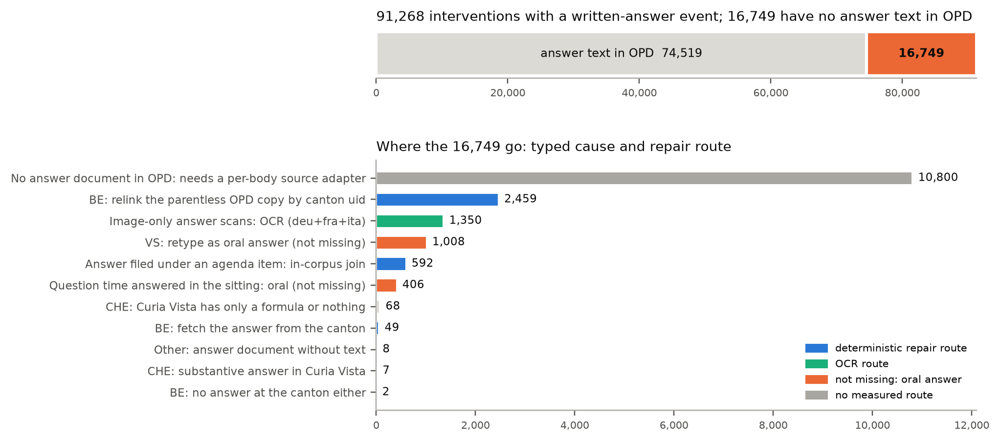
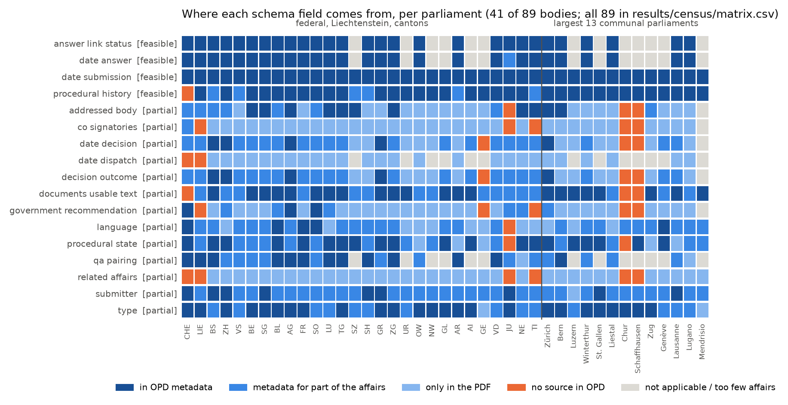
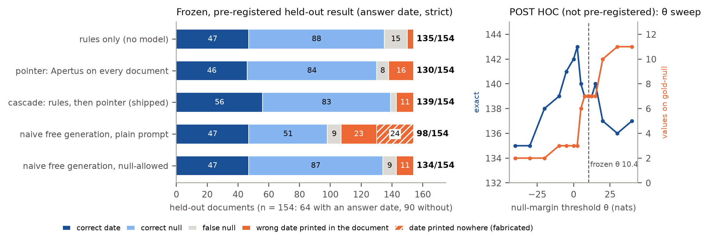

# Gegenprobe — where Swiss parliamentary answers go missing, how to put them back, and a converter whose every value is printed in the source

Track 2A · OpenParlData · Team 444 · **Evidence site: https://gegenprobe.mi11ion.io** · report: `technical_report.md`

- **Census.** Of 91,268 interventions whose events record a written government answer, **16,749 (18.4%) have no answer
  text in OpenParlData (OPD)**, 1,008 of them Valais oral answers filed as stub documents. Every one has a typed cause:
  filed under an agenda item, stored without a parent, scanned without text, answered orally, or not in OPD at all.
- **Repair lists keyed on OPD ids.** In Bern the answers are in OPD but unlinked. OPD confirmed the bug and its root
  cause (correspondence, 10 Oct 2026), and that our relink list (2,459 relinks + 49 fetches) is the workaround until
  its fix ships. A second list fixes 727 Bern `begin_date` values that are load timestamps. Deterministic routes repair
  3,107 of the 16,749; 11,206 need per-parliament source adapters, the next step.
- **A schema verdict with evidence.** The concepts are shared; what differs is where the value lives, the vocabulary and
  the date roles. 4 of 17 fields are feasible from OPD metadata alone, 13 partial, 0 fundamentally different; "answer
  date" is shared only with a role split (decided, dispatched, registered).
- **A converter whose every value is printed in the source document**, with page and character span, or is a typed
  null. It can still pick the wrong printed date: the default rules on 4/154 held-out documents, Apertus on 8/62
  documents from parliaments no rule was written for. So rules run unattended and Apertus's values are review
  suggestions. **Where Apertus earns its place:** on 15 parliaments the rules never saw it finds 24/29 answer dates
  where the rules find 2/29, exact on 53/62 documents against 44/62 for the best one-line baseline and 35/62 for the
  rules; it wins in 6 parliaments and loses in none (sign test p = 0.031; document-level McNemar as registered, p = 4.8 ×
  10⁻⁷). On whole affairs it completes the answer date (22/27 → 27/27).
- **Virtual affairs for communes that publish only minutes** (OPD named virtual affairs one of the points of the
  challenge). From 6 held-out sittings of Bulle's council, rules derive 99 affairs with item precision 99/99, every
  title right, the decision found for 49/63 items and invented for none of 36. Two registered hypotheses failed: recall
  99/120 stayed below the bar (H1), and Apertus added no significant decisions (H3). On a second commune the items
  transfer (9/9) but the decisions do not (0/9): decision parsing is commune-specific.



**Glossary.** *Pointer*: Apertus chooses one of the dates printed in the document, or null; it cannot write a value of
its own. *Typed null*: an empty field that says why (not in the document, unlinked, scan, oral, ...). *Residue*: the
documents where the rules find nothing and stay silent. *Review mode*: Apertus runs on the residue and its choice
arrives as a suggestion with page and span for a person to accept. *Null margin (θ)*: how much more likely Apertus
finds "no answer date" than all printed dates together; above θ it says null. *Virtual affair*: an affair rebuilt from an agenda
item and its minutes, for councils whose business exists only as meeting documents.

## Quickstart

```bash
make run              # Docker, CPU, clean checkout: replays P1-P4 and recomputes Apertus's decisions from the cache
make census-replay    # recompute census, link status and feasibility matrix from data/census only (host Python 3.11)
make test             # unit tests (pip install -e .[dev])
```

`make run` needs nothing but Docker; network is optional (live steps report SKIP offline). It exits non-zero on any
failure and writes `out/site/index.html`, the same evidence viewer as https://gegenprobe.mi11ion.io. It recomputes the
census and asserts it equal to `results/census/`; replays the Bern join and its triple check; runs sample documents
through the converter with the validator's span, typed-null, footer-distractor and self-deletion checks; re-scores
P1–P4 from the committed predictions and labels, re-runs the four registered hypothesis scripts and verifies the four
LOCK files; re-derives the P1 rules arm from the source PDFs fetched by sha256; recomputes every P1 and P2 Apertus
decision from the committed model cache (cache only, frozen code); and recomputes every number in this README, the
report and the form notes from a results file (`claims.tsv`: 509 claims, matched as whole tokens, short values pinned
by a context phrase). Locally the rules arm re-derives 154/154 and the Apertus decisions 154/154 (P1) and 62/62 (P2)
identically. In the Docker run on GitHub's CI the time budget allowed 113 of 154 rules re-derivations, and 128 of 128
recomputed Apertus decisions matched; 14 prompts missed the cache because that image's poppler extracts slightly
different text, which the step reports as WARN, never as PASS. Optional: `LLM_NAME` / `LLM_BASE_URL` / `LLM_API_KEY`
for a live Apertus slice, or `make run GGUF=1` for Apertus v1.5 8B (GGUF Q4_K_M, sha256-pinned) in-process on CPU.

**Convert your own PDFs** (guide, field glossary and null reasons in plain words: `docs/convert-your-own.md`):
```bash
python -m gegenprobe convert <pdf-or-url>                        # one document, no model: JSON with page, span, rule
python -m gegenprobe convert --batch inputs.tsv --out out.jsonl  # many, resumable; fetch failures are typed rows
```

## What is in the repository

| Deliverable (challenge) | Where |
|---|---|
| Representation model: versioned schema + controlled vocabularies | `src/gegenprobe/schema/schema_v0_1.py` (Pydantic, normative), `data/schema/*.json`, JSON Schema `results/schema/*.schema.json`, `docs/schema.md`; mapping to Popolo / Akoma Ntoso / Parla-CLARIN / OParl in `docs/mapping.md` |
| Converter: prompts + code, provenance per value | `src/gegenprobe/convert/` (lattice → rules → pointer → cascade, modes), prompts `src/prompts/{de,fr,it}/`, CLI + batch mode, `docs/converter.md` |
| Whole affairs (multi-field) | `src/gegenprobe/affair/` (metadata → rules → closed-set pointer per field), `docs/affair.md` |
| Virtual affairs from agendas and minutes | `src/gegenprobe/virtual/` (`python -m gegenprobe.virtual derive …`), `docs/virtual-affairs.md` |
| Validator | `src/gegenprobe/validate/` (schema, span re-check, typed-null consistency, self-deletion and distractor harnesses) |
| Evidence: four pre-registered evaluations | `eval/prereg/` (held-out, seen parliaments), `eval/prereg2/` (unseen parliaments), `eval/prereg3/` (whole affairs), `eval/prereg4/` (virtual affairs), each with its `DEVIATIONS*.md`; gold sets `data/gold*/` with raw annotations, `docs/gold_protocol.md` |
| Cross-parliament question | answer rates and answer times per parliament: `results/census/question.json`, site → Parliaments (CSV) |
| Research dataset | `results/census/interventions.tsv.gz`: 91,268 interventions × 23 columns with date-trust tiers and source links (CDLA-Permissive-2.0) |
| Census, feasibility matrix, comparability, data-quality findings with OPD's response | `src/gegenprobe/census/`, `results/census/`, `docs/census.md` |
| Repair lists keyed on OPD ids | `results/repair/repair_BE*.tsv`, `docs/repair.md`, `docs/runbook.md` |
| Nightly job (systemd timer + container, alerts) | `src/gegenprobe/monitor/`, `deploy/nightly/`, `docs/nightly.md` |

## Is a common schema feasible?

Partly, and the evidence says exactly where it breaks. Over 17 fields and 89 parliaments with affairs in scope (OPD
scrapes 90), by criteria written down before computing (`docs/census.md` §3; recomputed at other thresholds in
`results/census/tier_sensitivity.json`): **4 feasible** from OPD metadata alone (submission date, answer-event date,
procedural history, answer-link status), **13 partial** (in the metadata for some parliaments, only in the PDF for
others), **0 fundamentally different** at the frozen thresholds (5 at a 10% no-source threshold). The tiers say where a
value lives; whether it *means* the same thing everywhere is a second question, answered from OPD's own vocabularies
(`results/census/comparability.json`, classes in `data/schema/field_verdict_classes.json`):

| class | fields and concepts | evidence |
|---|---|---|
| **shared** | submission date, submitter, co-signatories, addressed body, government recommendation, decision and dispatch dates, Q/A pairing, related affairs, language, usable text, answer-link status | one meaning everywhere; only where the value lives differs (government recommendation: 0 ambiguous labels) |
| **shared with a role split** | **answer date**, procedural history, type, procedural state, decision outcome | "answer date" is at least three dates (decided, dispatched, registered): in 7 of 54 bodies the "answer" event is mostly the submission date, and on our held-out gold OPD's event equals the printed date for 37/44 documents; 35 event labels carry different date roles, 42 of 1,038 raw type labels map to different harmonised types, 32 state and 3 outcome labels are ambiguous; 29.1% of events have no harmonised id |
| **body-specific** | oral answers in question time, executive business that answers no member's affair, councils that publish only meeting documents | 20.7% of question-time answers are oral; 16 bodies publish only meeting documents (8 have no affair at all); schema v0.1 marks affairs derived from them `virtual` with `derived_from` (P4) |

Schema v0.1 adds date roles, typed nulls and, since 10 Oct, `QAItem` (question *n* paired with the answer to question
*n*; the converter does not fill it yet). The Pydantic models are normative; the exported JSON Schema for OPD's
workbench cannot express the cross-field rules (a rule value must carry page and span), so validate with the models.
Where OPD metadata carries a field, it mostly agrees with print (P3: type 17/18, submitter 23/28, submission date
15/21; affair numbers 21/29, format differences).



## Repair lists for OPD (`docs/repair.md`, `docs/runbook.md`)

- **Bern.** Of the 3,532 answers the canton publishes, OPD attaches 229 (6.5%) to their affair; 3,394 (96.1%) are
  linkable within OPD without any model (229 attached, 527 under an agenda item, 2,638 parentless documents carrying
  the canton's document id). The relink list covers the parentless ones whose affair still lacks its answer (2,459, plus
  49 to fetch from the canton); the other 179 parentless answers are not missing (155 affairs already have the text, 24
  have no written-answer event). Every relink was checked against OPD's own copy of the document: affair number and
  answer heading 2,459/2,459; decision date equal to OPD's answer event 2,332 with the registered parser and 2,421
  [97.9, 98.9] with a second parser written after the registered run; the remaining 38 go to review
  (`results/repair/be_verify_all.json`). On the pre-registered sample of 40 the date check was 36/40: three misses were
  our parser on 2020–21 headers, one a typo in the canton's own PDF. All Bern numbers are reconciled in one table
  (site `#bern-numbers`, `results/repair/be_reconcile.json`).
- **Bern `begin_date`.** 727 affairs carry a load timestamp: 557 on 2024-10-28 and 170 from later loads, the two groups
  OPD described; 554 get the date of their own "Eingereicht" event, 173 go to review (`repair_BE_begin_date.tsv`).
- **Coverage.** Deterministic routes (Bern relinks and fetches, agenda joins, federal Curia Vista) repair 3,107 of the
  16,749 missing answers. 1,008 Valais "missing" answers are oral answers filed as a stub, to retype rather than to
  find; German+French+Italian OCR recovered 15/15 image-only answers in a probe (1,350 affairs on that route); 11,206
  need per-parliament source adapters, the next step.


## Evaluation: four pre-registrations

Every test froze code, prompts and θ by sha256 before any label existed. GitHub's clock (first Actions run per push,
`results/eval/lock_server_times_all.json`) shows the order: P1 LOCK `912bda2` (orig. `812030f`) 2026-10-09T19:38:07Z
→ labels `6eb4d3b` (orig. `ded0033`) 2026-10-09T19:44:06Z; P2 LOCK2 `5b044a2` (orig. `3dde418`) 2026-10-10T07:48:00Z
→ labels `dbf387e` (orig. `2e4a9d6`) 2026-10-10T07:50:28Z; LOCK3 + LOCK4 `a0e4636` (orig. `922218d`)
2026-10-10T08:41:08Z → P3 labels `7750b6c` (orig. `d90bae7`) 2026-10-10T08:44:45Z → P4 labels `8cf32f9` (orig.
`8a40ca1`) 2026-10-10T08:45:11Z. Commit messages were later rewritten
to drop assistant trailers, trees and dates unchanged; old → new SHAs in `docs/commit-map.md`. The annotators are agents,
so labelling takes minutes; the clock proves order, not effort. Gold labels come from two blind annotators (Claude Opus
and Sonnet) and a tie-breaker, quotes verified by code, no human labels by design; the raw annotations are committed so
agreement recomputes. Deviations are listed per test (`eval/prereg*/DEVIATIONS*.md`).

**Which Apertus.** All Apertus results so far are the 70B weights, served by Public AI under the name
`swiss-ai/apertus-v1.5-8b` (measured, report §3). The real 8B (GGUF) arms are running on CI. Unit: one document's answer
date, strict.

**P1 — 154 held-out documents from parliaments the rules were written for** (DE/FR/IT × canton/commune + Ticino scans;
64 with an answer date, 90 without; always-null scores 90/154):

| arm | exact [95% CI] | dates found | wrong printed date | fabricated | values on the 90 answerless |
|---|---|---|---|---|---|
| **rules only (default mode)** | **135/154 [81.5, 92]** | 47/64 | 4 | 0 | 2 |
| Apertus pointer on every document | 130/154 [77.9, 89.3] | 46/64 | 16 | 0 | 6 |
| rules + Apertus suggestions, all accepted | 139/154 [84.6, 94] | 56/64 | 11 | 0 | 7 |
| naive free generation, null-allowed | 134/154 [80.8, 91.4] | 47/64 | 11 | 0 | 3 |
| naive free generation, plain prompt | 98/154 [55.8, 70.8] | 47/64 | 23 | 24 | 39 |

8B rows: pending the CI run (workflow `arms-8b`, GGUF Q4_K_M on CPU, own θ).

Outcomes as registered: null safety failed (7/90 answerless documents get a value; 95% upper bound 15.2% against 10%);
Apertus over rules is not significant (+3.6 points on FR/IT/scans, 95% CI −1.4 to 9.3, p = 0.22), so rules run
unattended and Apertus's answers are review suggestions; the null margin separates answered from answerless documents
(AUROC 0.969 on all documents, 0.966 on the registered length-matched set); 3 of 8 Apertus-decided French/Italian
values are wrong. A one-line baseline (latest printed date, only on documents OPD types as answers) is exact on 131/154.

**P2 — 62 documents from 15 parliaments absent from every dev and held-out set** (29 with an answer date, 33 without;
always-null scores 33/62; annotators agreed on all 62 dates, κ 1.0):

| arm | exact [95% CI] | dates found | wrong printed date | fabricated | values on the 33 answerless |
|---|---|---|---|---|---|
| rules only | 35/62 [44.1, 68.1] | **2/29** | 2 | 0 | 0 |
| **Apertus pointer** | **53/62 [74.7, 92.2]** | **24/29** | 8 | 0 | 4 |
| rules + Apertus suggestions | 51/62 [71, 89.8] | 22/29 | 10 | 0 | 4 |
| naive free generation, null-allowed | 52/62 [72.8, 91] | 22/29 | 7 | 1 | 3 |
| naive free generation, plain prompt | 45/62 [60.4, 82.1] | 21/29 | 8 | 4 | 9 |
| *latest printed date on documents OPD types as answers (post hoc)* | *44/62* | *18/29* | *13* | *0* | *7* |

Outcomes as registered: the rules collapse off their home layouts (dates found 47/64 → 2/29); the pointer beats them
(22 documents only the pointer gets right, 0 only the rules; McNemar p = 4.8 × 10⁻⁷; without Bellinzona, whose letterhead
one rule happens to match, 17 vs 0, p = 1.5 × 10⁻⁵); the margin separates the classes (AUROC 0.983); null safety failed
again (4/33, upper bound 27.3%), so Apertus's values remain review suggestions. The 29 answered documents sit in 7
parliaments, so documents are not independent: post hoc, the pointer wins in 6 parliaments, the rules in 0, 1 tie
(sign test p = 0.031; DEVIATIONS2 D2-1). **Error profile** (`results/report/p2_numbers.json`): of 62 documents the
rules are right on 35, pick a wrong printed date on 2, date none of the answerless documents and miss 25 answer dates; the pointer
is right on 53, picks a wrong printed date on 4, dates 4 answerless documents and misses 1; rules + Apertus are right on
51, wrong date 6, answerless 4, missed 1. The combination scores below the pointer alone because Apertus is asked only
where the rules abstain: on 2 documents a rule (`rrb_vom`) fired with a wrong printed date, so Apertus was never asked;
no document goes the other way.

**P3 — whole affairs: 29 affairs (58 PDFs) from 10 parliaments, 5 with rules and 5 without, DE/FR/IT.** Arms: OPD metadata
only (M), rules only (R), the default metadata + rules (C), and C plus Apertus suggestions on the fields C leaves open
(CA). Annotators agreed on at least 27/29 affairs on every field; 4 fields were tie-broken.

| field | M | R | **C (default)** | C + Apertus |
|---|---|---|---|---|
| type | 17/29 | 26/29 | **27/29** | 27/29 |
| affair number | 21/29 | 14/29 | **21/29** | 21/29 |
| submitter | 23/29 | 5/29 | **23/29** | 23/29 |
| submission date | 15/21 | 4/21 | **15/21** | 15/21 |
| answer date | 21/27 | 16/27 | **22/27** | **27/27** |
| addressed body (gold constant: a constant answer scores 28/28) | 0/28 | 4/28 | **4/28** | 23/28 |
| decision number (defect D3-1; post hoc C 5/17) | 0/17 | 5/17 | **0/17** | 0/17 |

Outcomes as registered: no field reaches the "unattended" bar (95% lower bound ≥ 0.80; type comes closest); number,
type, submitter, submission date and answer date are partial. Apertus suggestions on the fields the default leaves open
are right for 25/32 of those that have a value and 25/34 of its suggestions are right, but that count is dominated by
the addressed body, where every gold value is "executive": we withdraw it as evidence for Apertus (D3-3). Without it the
evidence is thin, 6/8 found and 6/9 right; the case rests on the answer date (22/27 → 27/27). Set fields, as
registered: co-signatories (from OPD metadata) precision 13/16, recall 13/29; related affairs (rules) precision 6/9,
recall 6/14. Decision number: registered C 0/17, because the frozen cascade's metadata branch drops the number the
rules found (D3-1); taking the rule's number gives 5/17, the same as rules alone. Details: `docs/affair.md`.

**P4 — virtual affairs from minutes: 6 held-out sittings of Bulle's council, 120 agenda items.** Deterministic parsing
derives 99 items as virtual affairs: item precision 99/99, titles 99/99, type 91/99 (H2 holds), meeting date 6/6 (H4
holds), decision found for 49/63 items (46/63 correct), invented for 0/36. **H1 failed**: recall 99/120 (82.5%, sub-items
and unnumbered lines) below the registered bar. **H3 failed**: Apertus added 2 decisions (p = 0.5). Registered transfer
cell (exploratory, DEVIATIONS4 D4-4): 2 sittings of La Chaux-de-Fonds, the only French-speaking frontier commune with both
agenda and minutes in OPD; items 9/9 and titles 9/9, but the rules find 0/9 decisions, and with Apertus 2/9 are found, 1
correct: decision parsing is commune-specific (the two annotators agreed on 7/9 of these decisions, κ 0.4, so read the
decision cell as indicative). Details: `docs/virtual-affairs.md`.

**What the four tests say together.** Apertus earns its place where the layout varies and no rule exists: on
parliaments nobody wrote rules for (P2: 53/62 against 44/62 for the best trivial baseline and 35/62 for the rules; 6
parliaments to 0) and for the answer date of whole affairs (P3: 22/27 → 27/27). Where structure is regular — the
parliaments the rules were written for (P1) and Bulle's minutes (P4) — rules suffice. A well-prompted 70B is about as
accurate on answer dates (P1 134 vs 139, P2 52 vs 53), but it can write a date printed nowhere (1 in P2, 24 with the
plain prompt in P1) and returns no span; the pointer returns only printed dates, each with page and span for the
reviewer.



## Use of Apertus

- **Where:** only in the converter, as a closed-set pointer: forced choice over the dates (or enum labels, or OPD affair
  numbers) printed in the document, plus null; summed log-probabilities; null if the margin exceeds θ, fitted per build
  on dev documents and frozen (θ = 10.40 for the Public AI build). Free generation is run only as the naive baseline.
- **Why a pointer:** asked freely when the government answered, Apertus writes a precise date for 15/15 (local 8B) and
  14/15 (70B) Bern interventions that have no answer, often the "Letzte Bearbeitung" footer (earlier spikes, cited); a
  null-allowed prompt fixes this on the 70B but not on the local 8B (still 14/15).
- **Modes:** `rules_only` (default, unattended, no model) and `review`: Apertus on the rules' residue, its value attached
  as a suggestion with page, span, margin and `needs_review: true` for OPD's existing manual-review step. Recommended
  for the 74 of 89 parliaments without rules (P2) and for the answer date of whole affairs (P3), with a reviewer gate.
- **Builds:** Public AI's `swiss-ai/apertus-v1.5-8b` name serves the 70B weights (measured; report §3), so those results
  are labelled 70B. The real 8B runs as GGUF Q4_K_M on CPU; θ does not transfer between builds, so each gets its own.

## Sovereignty, operations, cost

| Service (runtime) | What is sent | Needed for |
|---|---|---|
| files.openparldata.ch (exports) — or none, with `GP_EXPORTS_DIR` | GET only | census, nightly job |
| ogd.parl.apps.be.ch, rrgr-service.apps.be.ch (canton Bern) | GET; an affair number for the per-affair route | Bern repair |
| fedlex.data.admin.ch (SPARQL), www.fedlex.admin.ch (filestore) | a citation such as "BBl 2014 9657" | federal placeholder repair |
| document hosts listed in OPD | GET of a public PDF | conversion, triple check |
| huggingface.co, only with `GP_GGUF=1` | GET of the pinned GGUF (once) | local 8B |
| the LLM endpoint the operator sets (`LLM_BASE_URL`) — or none | text of public parliamentary documents | review mode |

ws.parlament.ch (Curia Vista) was queried once for the federal answers missing from the texts export; it is not part of
the running system. The evidence site on Cloudflare is documentation, not runtime. With `GP_GGUF=1` no document text
leaves the machine; Public AI was used for development and evaluation only (it may route outside Switzerland).
`api.openparldata.ch/robots.txt` reads "Block all API data endpoints (not for SEO)" above `Disallow: /v1/`; we use the
nightly bulk exports, which also makes every number reproducible from a dated snapshot.

- **Designed to run inside OPD.** Pointed at the export directory (`GP_EXPORTS_DIR`), a full nightly run takes 96.8 s of
  one core with 0 bytes of export transfer (`results/monitor/run_local_exports.json`).
- **Hardened.** The container never runs as root (uid 10001, all capabilities dropped, no-new-privileges, 4 GB / 2 CPU
  ceiling). Untrusted PDFs are bounded: 50 MB per file, 300 s per pdftotext/tesseract call, 600 s per document; each
  hit is a typed failure row, never a hung night. robots.txt fails closed: a host whose robots.txt cannot be read is not
  fetched that night. Alerts go to an outbox before the night's state is committed, so a down webhook delays an alert,
  it never loses it. One configurable User-Agent, at least 1.2 s between requests to one host.
- **Research dataset.** `results/census/interventions.tsv.gz`: one row for each of the 91,268 interventions, with
  submission and answer dates, where the answer text is, the OPD page and the parliament's own page, and a per-body
  date-trust tier, because OPD's "answer" date is verified only in Bern (2,421 of 2,459 relinks carry the printed date)
  and elsewhere ranges from a weekly cabinet sitting day to the submission date (`results/census/date_trust.json`).

**Cost** (`results/report/cost.json`, `results/report/cost_end_to_end.json`; one core, no GPU). End to end, a document
costs about 2.1 s to fetch politely, extract and check (50 federal documents), plus 6.9 s per page where OCR is needed;
the rules themselves process 480 documents per second, about 0.5 CPU-hours for all 902,754 documents in OPD's export.
Re-deriving the 154 held-out documents from their PDFs (22 of them scans) took 727 s. Review mode adds the pointer on
the rules' residue (97/154 held-out documents): 3.5 calls and 5,905 billed prompt tokens per residue document on the
70B; the 8B cost per residue document is pending the CI run. At ten times OPD's volume, rules need about 5 CPU-hours
and review mode about USD 3,357 at Public AI's list price.

## Maturity, limitations, coding assistants

- **Maturity per component:** census and repair lists: deployable prototype (lists keyed on OPD ids, reproduced in every
  `make run`). Nightly job: deployable prototype (systemd units, container, alerts, runbook, local-exports mode).
  Converter, rules-only mode: tested prototype (154 held-out + 62 unseen documents). Review mode with Apertus: feasibility
  study with a reviewer gate. Whole affairs and virtual affairs: feasibility studies (no field unattended yet; one
  commune for minutes). Schema v0.1: draft for the eCH group.
- **Limitations:** answer dates are the field evaluated in depth; 11,206 missing answers need per-parliament adapters
  that are not built; no federal documents in any gold set; spans index our own pdftotext/tesseract text, though
  `--opd-text` maps values onto OPD's stored text.
- **Coding assistants:** Claude Code agents (Anthropic) wrote most code, documentation and the gold labels; no human
  labelled or adjudicated a gold value, by design. Correctness rests on code-level checks — spike numbers reproduced
  cell-for-cell, regression fixtures, `claims.tsv`, the pre-registration locks, verbatim-quote checks, re-derivation
  from source PDFs — not on reading.

## Licences

Code: Apache-2.0 (`../LICENSE`). Report: CC-BY-4.0 (`docs/LICENSE-report.txt`). Data in `data/`: CDLA-Permissive-2.0
(`data/LICENSE`): identifiers, URLs, hashes, counts, labels and short quotations only — no full document texts and no
personal contact data.
