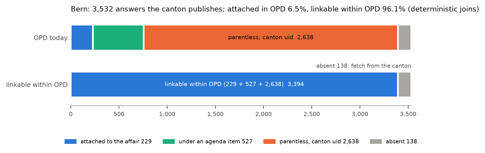

# Operations in detail: the lists for OPD, running it, sovereignty and cost

The full record behind the "Ready for OPD" and "Operations" sections of [`../README.md`](../README.md). Paths are
relative to `track_2a/`. Every number here is listed in `claims.tsv` and recomputed by `make claims`. Step-by-step
commands for an operator: `docs/runbook.md`; the lists themselves: `docs/repair.md`, `docs/adapters.md`.

## The census in detail

The census streams OPD's exports once and gives every in-scope affair an answer-link status (`attached | agenda |
parentless | absent | image_only | oral`). Of 91,268 interventions whose events record a government answer,
16,749 (18.4%) have no answer text attached in OPD (the registered count; 2,177 of them are in OPD with text under a
heading the census lexicon does not recognise, so at most 14,572 lack it). 1,422 of them were answered orally in the sitting (1,016 Valais oral-answer
stubs, 406 question-time answers; Graubünden's *Fragestunde* accounts for 367 of those), so no written text is expected.
Subtracting them leaves at most 13,150 written answers without answer text on their intervention (14.6% of the
89,846 answered in writing). Each is typed by cause: filed under an agenda item, stored without a parent, scanned without text, or
not in OPD at all. Answer times are not one quantity across parliaments, because OPD's "answer" date has different
roles: the median is 112 days where it is the verified decision date (Bern, Ticino), 79 where it falls on a
government's weekly sitting, 62 for mixed and 39 for diffuse, publication-like dates, and in 7 parliaments the
"answer" is the submission date (`results/census/answer_days_by_trust.json`). The evidence site compares answer times within one
intervention type (median and IQR per type; not a league table, since procedures differ), shows 31 parliaments whose
answers OPD barely covers (among the cantons SZ, UR, GL, AI, NW and GE) as a coverage-gap status rather than as
unanswered questions, and filters to cantons. Cantons are named by their official name in the language of their
majority (Ticino, Vaud, Genève, Valais, Fribourg; Graubünden, Bern, Luzern), cities and communes by OPD's name.

**Census at a glance** (OPD exports of 6 Oct 2026; `results/census/corrected.json`; open dataset of all 91,268).
2024–25: the registered count is 1,855 (367 oral); 150 are in OPD under an unrecognised heading, so at most 1,338
written answers lack text. Bern: 567 of 593 written answers from 2024–25 (96%) lack text, but 520 of them are in OPD
unlinked (418 under an agenda item, 102 without a parent). Coverage gaps: 31 parliaments where OPD holds interventions
but records almost no written answers (canton SZ: 1,316 interventions, 0 answers): OPD coverage, not unanswered
questions. After every counted repair 92.3% of the 91,268 have answer text, up from 81.6% attached today: 85.6%
with the 3,621 repairs from what OPD already holds (agenda joins, category tags, verified text of its own copies),
88.3% after OPD's hash decision for the 2,459 Bern relinks, 92.3% once the 3,640 checked fetches are loaded
(`results/report/r9_numbers.json`). The 554 `begin_date` corrections are a separate field, not among the 9,720.

## Repair lists for OPD (`docs/repair.md`, `docs/runbook.md`)

- **Bern.** Of the 3,532 answers the canton publishes, OPD attaches 229 (6.5%) to their affair; 3,394 (96.1%) are
  linkable within OPD without any model (229 attached, 527 under an agenda item, 2,638 parentless documents carrying
  the canton's document id). Every candidate was checked against OPD's own copy of the document: affair number and
  answer heading 2,459/2,459; decision date equal to OPD's answer event 2,332 with the registered parser and 2,421
  [97.9, 98.9] with a second parser written after the registered run. On the pre-registered sample of 40 the date
  check was 36/40: three misses were our parser on 2020–21 headers, one a typo in the canton's own PDF. The other 179
  parentless answers are not missing (155 affairs already have the text, 24 have no written-answer event). All Bern
  numbers are reconciled in one table (site `#bern-numbers`, `results/repair/be_reconcile.json`).
- **Downloads.** All four Bern lists, the dry-run apply plan and the JSON Schemas are direct downloads on the evidence
  site (https://gegenprobe.mi11ion.io/downloads/repair_BE_relink.tsv etc.; box "For OPD's data team"), next to the
  repository link.
- **Counts per file.** 2,459 relink candidates = 2,421 in `repair_BE_relink.tsv` (all checks pass) + 38 in review;
  49 fetch candidates = 48 in `repair_BE_fetch.tsv` + 1 in review; `repair_BE_review.tsv` holds those 39. Apply the
  relinks first, as a protected override or after OPD's staging fix, then the fetches; review rows need a person.
- **Applying them.** `python -m gegenprobe.repair.apply_be --fetch --out DIR` reads today's `docs_BE` export and writes
  an apply plan: per row the before-state (current parent, `hash`, file URL), the after-state, and guarded `UPDATE`
  statements as text; it changes nothing in OPD. **A note for OPD:** the document `hash` is sha256(body_key +
  parent_type + url) (all 49,810 rows of the 10 Oct export follow it), and all 2,421 verified relink documents are
  stored as `parent_type = agenda`, so relinking changes each one's identifier and its `files.openparldata.ch/doc` URL
  unless OPD keeps the old one (`--hash keep`); the plan lists both values. `python -m gegenprobe.repair.acceptance
  --fetch --out DIR` counts how many relinks OPD has attached and can gate a deployment.
- **Bern `begin_date`.** 727 affairs carry a load timestamp: 557 on 2024-10-28 and 170 from later loads (column
  `opd_group`), the two groups OPD described; 554 get the date of their own "Eingereicht" event, 173
  go to review (`repair_BE_begin_date.tsv`).
- **Coverage.** Before the source adapters, deterministic routes (Bern relinks and fetches, agenda joins, federal Curia
  Vista) proposed repairs for 3,107 of the 16,749 without answer text; with them, 9,720 (next bullet: 9,089 checked
  row by row, 592 agenda joins never sample-checked, 39 Bern rows in review). The retype list holds 1,008 Valais answers, confirmed by the exact text
  rule, that were given orally and filed as a stub: they are retyped as oral, not searched for (the length proxy finds
  1,016 such stubs; `results/census/vs_reconcile.json`). For 1,350 affairs whose answer OPD holds only as an image, a probe ran German+French+Italian OCR on 15
  image-only answers: all 15/15 gave text passing our usability check (≥ 200 characters, an answer heading, a parseable
  date), a coarse check that an English-only model also passes; re-taking a text version is cheaper where the parliament
  publishes one. 10,800 written answers had no answer document anywhere in OPD (406 more are oral question
  time).
- **Source adapters for 50 parliaments** (`src/gegenprobe/repair/adapters/`, `docs/adapters.md`; model-free). Routes of
  their own for the parliaments with the most missing answers (Zürich canton and city, St. Gallen, Ticino, Neuchâtel,
  Jura, Valais, Solothurn, Luzern, Aarau) and a reader of OPD's own documents for every other parliament verify 6,613
  more answers: 5,793 of the 10,800 without an answer document and 820 of the 1,350 image-only ones. Each is checked by
  affair number or title, the parliament's answer formula and a date check, and typed filters reject documents that
  only look like answers (deadline extensions, commission reports, minutes, the member's own text, another affair).
  Verification tiers: 5,161 whose own date equals an OPD event; 1,056 where a printed date equals an OPD answer
  event and the document's own date, if read, lies within 30 days of one (rows more than 30 days off go to review);
  396 within the parliament's documented window (at most 15 days in Zürich city, 120 in Valais). Listed separately and **not counted**: 282 Jura answers that match by
  identity and wording only (OPD's Jura answer events carry no date), and 917 rows that wait for a person (214 of them
  promoted by Apertus into the separate tier `promoted_by_apertus`, P7). **Repairs are proposed for 9,720 of the
  16,749; the adapters looked at 5,007 more without a counted row, 943 of which wait for a person.**
  2,177 of the answers the census counts as missing are already in OPD with text, filed under the question's file and
  worded in a way our frozen census lexicon does not list (Zürich city alone: 1,417, "Der Stadtrat beantwortet die
  Anfrage wie folgt"): the repair is a category on the document (`tag_answer`), not a new document. The registered
  census number itself is unchanged: it is an upper bound under a frozen lexicon (at most 14,572 lack text).
- **Audits of the adapter rows.** A design audit of 796 rows (Claude annotator) found the document types the checks
  could not tell from an answer: 34 non-answers among 511 verified rows. The filters written from it catch all 34 and
  remove none of the sample's 713 answers (a design-sample check, not a precision estimate). **Blind audit v3**
  (`results/repair/adapters/audit3/`, prompt `PROMPT.md`): 200 counted rows, stratified by tier and route, and 60
  decoys from the review and failed lists, shuffled into packets that carry no outcome, reason or proposed action. The
  packets do carry the text's sha256, which joins to the committed lists. The audit is therefore blind for Qwen, which
  saw only the prompt, and blind by instruction for Claude, which ran in a checkout. The key's hash reached GitHub at
  00:56:16 UTC on 11 Oct (commit `ce416a8`), before the Claude verdicts were finished and before any scoring. Claude Opus judged **197/200** counted rows to be the executive's
  answer (Wilson 95.7% to 99.5%; a plain proportion over a stratified sample), and the date wrong or unsupported on 15.
  It rejected 60% of the failed decoys but only 1.5% of the counted rows, and called 77% of the review decoys answers:
  the pipeline errs on the side of review. A second auditor from another vendor, Qwen-SEA-LION, accepted 200/200 but
  was lenient on decoys; the two agree on 252/260. Both auditors are language models, by design (no human labelling).
- **A compliance bug we found and disclosed ourselves** (`docs/incidents.md`, `results/compliance/`). Our network
  layer checked robots.txt with Python's `urllib.robotparser`, which applies the first matching rule; RFC 9309
  requires the longest. www4.ti.ch (Canton Ticino) lists `Allow: /` before its `Disallow` lines, so between 9 and 11
  Oct 2026 the project requested 147 distinct URLs on paths it disallows, 133 of them downloads, mostly by the gold-set
  samplers that fetched the parliament's URL OPD records; CI runs repeated at most 4,942 downloads before the fix
  (counted per executed fetching step of all 112 runs; each process kept 1.2 s between its requests, and at most 8
  ran at once). An
  audit of all 14,152 URLs the project fetched found no other host affected. Since 11 Oct one RFC 9309 matcher
  (`src/gegenprobe/robots9309.py`) judges every fetch, and every fetch path requests a mapped URL from OPD's own copy
  on files.openparldata.ch instead (`data/compliance/mirror_urls.json`); 126 of the 130 evaluation documents are
  byte-identical to OPD's copy, so a re-derivation from OPD gives the same text. Local copies that could not be shown
  identical were deleted.



## Running it: `make run`

```bash
make run              # Docker, CPU, clean checkout: replays P1-P8, re-derives the rules arm, checks claims.tsv
make census-replay    # recompute census, link status and feasibility matrix from data/census only (host Python 3.11)
make test             # unit tests (pip install -e .[dev])
```

`make run` needs Docker; building the image fetches pinned packages, after which the network is optional (live steps,
such as re-deriving the rules arm from the source PDFs, report SKIP offline). The container runs as the
caller's uid, or uid 10001 when the caller is root, with a read-only root filesystem, a private `/tmp`, all capabilities
dropped and `no-new-privileges` (`Makefile`, target `run`). It exits non-zero on any failure and writes
`out/site/index.html`, the same evidence viewer as https://gegenprobe.mi11ion.io. It recomputes the census and asserts
it equal to `results/census/`; replays the Bern join and its triple check; runs sample documents through the converter
with the validator's checks; re-scores P1–P4 and P3b from the committed predictions and labels, re-runs the nine
registered hypothesis scripts (P1–P8) and the 8B analysis and verifies the nine LOCK files (P7 replays from the
committed copies in `data/p7/` through `eval/p7/replay8.py`: LOCK8, the frozen hypotheses script and the dev table,
byte-identical, and its post-hoc files through `eval/p7/offline.py`; P8 re-runs its frozen scorer and decision script
from `data/p8/p8_gold.jsonl`, byte-identical, with LOCK9); re-derives schema v0.2 for the converter's own P3, P3b and
P5 records and the P8 gold (171 affairs, all must validate, byte-identical); re-derives the P1 rules arm from the
source PDFs (fetched by sha256) and recomputes P1 and P2 Apertus decisions from the committed model cache (cache only,
no model call) within a time budget; and runs the claims check: each number listed in `claims.tsv` is recomputed from
its results file, and the step fails if a document a claim lists does not print the claimed value (short values within
120 characters of their context phrase), if an anchor (`claims_anchor.json`: a phrase that holds a claim's value with
the words that name it) is not found in its document, or if a numeric token in the strict zones (the README, the technical report and the form
notes, each end to end; `claims_strict.json`; integers below 10 and listed non-claims such as dates aside) is not
bound to a claim by an anchor at its position, so that a number swapped for another valid claim of the same document fails. Locally the rules arm re-derives 154/154 and
the Apertus decisions 154/154 (P1) and 62/62 (P2) identically. A CI run on main whose jobs all passed (run
38076870082, commit 15dd077, `results/ci/docker_make_run_38076870082.json`) ran `make run` in this hardened container
before P5 and P6 joined the replay: 22/22 replay tests (P1–P4, P3b, the 8B analysis, 5 locks), 141 of 154 rules re-derivations within the budget, all identical;
recomputed Apertus decisions matched 129/129 (P1; 25 prompts missed the cache because the image's poppler 22.12
extracts slightly different text) and 49/49 (P2; 8 hosts unreachable from CI; reported as WARN, never as PASS); 984
claims, 0 failing. Later commits add documentation and claims rows; each push re-runs the same job. Optional: `LLM_NAME` / `LLM_BASE_URL` / `LLM_API_KEY` for a live Apertus slice. `make run GGUF=1` loads Apertus v1.5 8B
(GGUF Q4_K_M, sha256-pinned) in-process on CPU and scores a few demo documents with the frozen scorer; the 8B numbers
below come from CI runs with the fast scorer and are replayed, not recomputed, by `make run`.

The run ends with two lines: the Apertus replay coverage ("Apertus replay: P1 132/154 decisions re-derived from the
model cache, 132 match (22 cache misses); P2 54/62, 54 match") and the result. A step that skipped is named on the
result line: offline, `RESULT PASS (offline: 3 steps skipped: convert, rederive, rederive_apertus) in … s`, and the
coverage line reads "P1 0/154 … (offline)"; the full report is `out/run_report.json` (`skipped`, `apertus_replay`).

## Convert your own PDFs

Guide, field glossary and null reasons in plain words: `docs/convert-your-own.md`.

```bash
python -m gegenprobe convert <pdf-or-url> --body SG                # one document, no model: JSON with page, span, rule
python -m gegenprobe convert --batch inputs.tsv --out out.jsonl --queue review.jsonl   # many, resumable
python -m gegenprobe convert answer.pdf --body SG --anchors docs/examples/anchors_SG.json --explain
```

The converter tells you when it is outside its knowledge. For a parliament the frozen rules were never written on, it
warns, sets `needs_review: true` and gives the null its own reason, `no_rules_for_body`, instead of a silent null. When
a document says more than the rule matched ("accepter partiellement la motion"), the value becomes `partial` and the
quote includes the qualifier. A date printed right after the answer heading, in a layout no rule vouches for, moves to
the top of `candidates` for a person to confirm; it is never written into the field. `--queue-nulls` also sends a
rules-only null answer date on an answer document to review, with the printed dates as candidates. `--affair-type`
accepts the vocabulary keys, their DE/FR/IT/EN labels and OPD's type names; an unknown value is an error, not silently
ignored. `--anchors` adds your own per-parliament anchors without forking the rules: they run only after the frozen
rules, and each value they produce is marked `route: user_anchor`, with page and span (`docs/examples/anchors_SG.json`
fills the answer date on both St. Gallen layouts a trial user brought; `tests/test_overlay.py`). `--explain` lists every
rule and anchor tried and why each did not decide. robots.txt is read per RFC 9309: a disallowed path is never fetched,
a 4xx robots.txt means no restrictions, an unreadable one blocks the host for the run. Fetch failures are typed rows.
A batch re-run converts an input again when the anchors file or an option changed (an options hash per row), and
`--anchors-review` keeps values from your own, unmeasured anchors flagged. When a document has no answer heading but a
letter address to the parliament ("An den Kantonsrat", "Au Grand Conseil", …) with a place-date line under it, that
date is offered first among the candidates (`suggested_by_letter_line`), never written into the field. Spans index our
own pdftotext/tesseract text; `--opd-text` maps them onto OPD's stored text. Tables, annexes and images are not
extracted.

Questions and answers (`python -m gegenprobe.qa_cli`) take the same per-parliament settings file (`--body KEY --anchors
FILE`, with `confirm_rules`, closing formulae and reprint headings) and `--explain`. A trial user from Solothurn found
the last answer running into the signature block, the reprinted member's text counted as reasoning and a false "no
recommendation" outside rule coverage. The last answer and the reasoning now end before the closing block, the
reasoning starts at the executive's statement, and with `--body` an uncovered recommendation is `no_rules_for_body` in
`left_open` instead of a false typed null (`docs/qa.md`; P5's registered results are unchanged). OPD type names such as `Auftrag` are accepted as aliases (`data/convert/affair_type_aliases.json`).

## Sovereignty, operations, cost

| Service (runtime) | What is sent | Needed for |
|---|---|---|
| files.openparldata.ch (exports) — or none, with `GP_EXPORTS_DIR` | GET only | census, nightly job |
| ogd.parl.apps.be.ch, rrgr-service.apps.be.ch (canton Bern) | GET; an affair number for the per-affair route | Bern repair |
| fedlex.data.admin.ch (SPARQL), www.fedlex.admin.ch (filestore) | a citation such as "BBl 2014 9657" | federal placeholder repair |
| document hosts listed in OPD | GET of a public PDF (and its robots.txt) | conversion, triple check |
| the parliaments' sites the source adapters read; one canary per source each network night (on by default) | GET of a public page or PDF (and its robots.txt) | adapter lists, canaries |
| huggingface.co, only with `GP_GGUF=1` | GET of the pinned GGUF (once) | local 8B |
| the LLM endpoint the operator sets (`LLM_BASE_URL`) — or none | text of public parliamentary documents | review mode |
| the webhook or SMTP relay the operator sets (`GP_ALERT_*`) — or none | the night's alerts | nightly alerts |

ws.parlament.ch (Curia Vista) was queried once for the federal answers missing from the texts export; it is not part of
the running system. The evidence site is static files only and makes no third-party request (fonts self-hosted, SIL
OFL); its links to OPD and to the parliaments' own pages are followed only when clicked. With `GP_GGUF=1` no document
text leaves the machine; Public AI was used for development and evaluation only (it may route outside Switzerland).
OPD's API robots.txt disallows `/v1/`; we use the nightly bulk exports, which also makes every number reproducible
from a dated snapshot. Every request carries `GP_USER_AGENT`; a network night warns when it names no contact.

- **One real night** (`results/monitor/night_real_38062530586/`, `report/r4d_numbers.py`). The nightly job, installed
  with `deploy/nightly/install.sh --venv` on a GitHub-hosted 4-vCPU runner and started by systemd, ran one network
  night against OPD's live exports: 4,997 s wall (83 min), of which 1,892 s reading the exports (198 MB of single
  exports downloaded and stored, 6.2 GB of docs/texts exports streamed once and not stored; the streamed bytes
  reconstructed from the index the night read, `results/monitor/night_real_bytes.json`) and about 50 min (by
  subtraction) the one-time triple check of all 2,508 Bern rows a first night does; 28 min of CPU, peak memory
  2,078 MB. It raised no alert; as a first night it had no previous state, so the drop and trend alerts could not fire.
  From round 5 on, every night counts the bytes it streams (`run.json` `bytes`). On live data it reproduced the Bern list (2,459 relink, 49 fetch); the triple check passed
  2,468 rows and sent 40 to review (the committed lists of the 6 Oct snapshot: 2,421 + 48 pass, 39 to review). This
  tests the install and the job on a standard runner; the same unit runs on any Linux host.
- **Two consecutive nights in the recommended Docker setup** (`.github/workflows/nightly-real-docker.yml`): the workflow
  builds the image, installs the Docker unit with `install.sh`, runs night 1, waits for OPD's next export and runs
  night 2 on night 1's persisted state, so the index diff, the ledger, retries, outbox redelivery and the drop/trend
  alerts run against a real previous night. Actions run 38098822336
  (`results/monitor/two_nights_docker_38098822336/`): night 1 took 86 min and streamed 6.4 GB; night 2, on night 1's
  state and OPD's next export, took 6.6 min, re-scanned the 12 bodies whose exports changed and streamed 1.19 GB; 0
  alerts, the Bern list unchanged (2,459 relink + 49 fetch). Night 2 also exposed a ledger-status bug (rows seen again
  lost their stored check verdict); it is fixed and covered by a two-night test (`tests/test_ledger_two_nights.py`;
  `results/monitor/two_nights_docker_38098822336/README.md`), and the real two-night re-run of the fixed code starts
  with OPD's next nightly export (12 Oct 00:30 UTC). Both nights ran on a standard GitHub runner; the job runs on standard Linux hosts.
- **Operator-facing details.** The recommended Docker unit bind-mounts `GP_EXPORTS_DIR` read-only at the same path; CI
  runs a network-mode night that way inside the image, on a root-owned, read-only fixture export directory with
  `--network none`. The adapter canaries are on by default (`GP_ADAPTER_CANARY=1` in the template); the live run of 11
  Oct verified 7 of 7 with no alert in 67.6 s (`results/repair/adapters/canary_runs/2026-10-11.json`).
  Development-only folders (exploration spikes, the developer's budget gateway) come from `GP_SPIKES_DIR` and
  `GP_GATEWAY_DIR`; nothing an operator runs reads either, and the second adapter auditor runs against any
  OpenAI-compatible server (`audit3 qwen --backend openai`). Fetching is fail-closed once the guard is loaded
  (sitecustomize, the installed .pth, or `ensure()` in every unlocked fetching module); `python -S`, or `python -I`
  without the installed .pth, bypasses it.
- **Designed to run inside OPD.** Pointed at the export directory (`GP_EXPORTS_DIR`), a night with no changed export
  files took 96.8 s wall on a copied snapshot with 0 bytes of export transfer (`results/monitor/run_local_exports.json`);
  a night that re-scans the files OPD changed over three days (80.6% of the docs bytes) is about 21.8 min (derived;
  a full re-scan is 25 min of one core; `results/monitor/night_cost.json`).
- **Hardened.** The container never runs as root: `make run` and the nightly unit run it as a non-root uid (10001 when
  the caller is root), read-only, with a private `/tmp`, all capabilities dropped and `no-new-privileges` (nightly:
  4 GB / 2 CPU ceiling). Untrusted PDFs are bounded: 50 MB per file, 300 s per pdftotext/tesseract call, 600 s per
  document; each hit is a typed failure row, never a hung night. A host whose robots.txt cannot be read is not fetched
  that night. Each event triggers one alert; a failed send keeps the alerts in an outbox, written atomically, and
  re-sends them the next night. An empty cache gives a message naming the command to run, not a traceback. CI runs
  `systemd-analyze verify` on the units and gates their `systemd-analyze security` exposure (venv unit ≤ 2.0, the
  job's own sandbox; Docker unit ≤ 5.0, which scores only the docker client, the job being confined by the container
  flags); the `systemd-units` job of CI run 38073556535 measured 1.2 and 3.9
  (`results/ci/systemd_security_38073556535.json`). CI pins
  every Action by commit SHA, checks gitleaks against its release sha256 and installs test dependencies with
  `--require-hashes`. At least 1.2 s between requests to one host.
- **Research dataset.** `results/census/interventions.tsv.gz`: one row for each of the 91,268 interventions, with
  submission and answer dates, where the answer text is, the OPD page and the parliament's own page, and a per-body
  date-trust tier, because OPD's "answer" date is verified as the government's decision date in two parliaments only:
  Bern (2,421 of 2,459 relinks carry the printed date) and Ticino (2,379 of 2,379 answers whose title names the decision
  date carry the same date in OPD). Elsewhere it ranges from a weekly cabinet sitting day to the submission date
  (`results/census/date_trust.json`).

**Cost** (`results/report/cost_end_to_end.json`; one core, no GPU). Per document, fetching politely, extracting and
checking takes about 2.1 s (50 federal documents), plus 6.9 s per page where OCR is needed; the rules themselves
process 480 documents per second, about 0.5 CPU-hours for all 902,754 documents in OPD's export. Re-deriving the 154
held-out documents from their PDFs (22 of them scans) took 727 s. Review mode adds the pointer on the rules' residue
(97/154 held-out documents): 3.5 calls and 5,905 billed prompt tokens per residue document on the 70B, USD 0.59 per
1,000 residue documents at Public AI's list price. The local 8B takes 180 s per document end to end on a 4-vCPU
machine (692 CPU-seconds, fetch and extraction included; 9.3 GB memory), about 50 machine-hours per 1,000 residue
documents; fitting its θ took 5.1 hours for 97 dev documents. Applied to OPD's whole export at the held-out residue
share (about 569k residue documents; an upper bound, since review mode runs only on new answer documents), the 8B would
take about 28,400 machine-hours on one such machine, the 70B about USD 336 at that list price. **At ten times OPD's
volume** the rules need about 5 CPU-hours and review mode about USD 3,357 at that list price; fetching and extracting
the documents (about 2.1 s each) dominates, not the rules.
